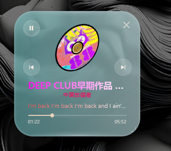
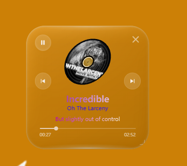
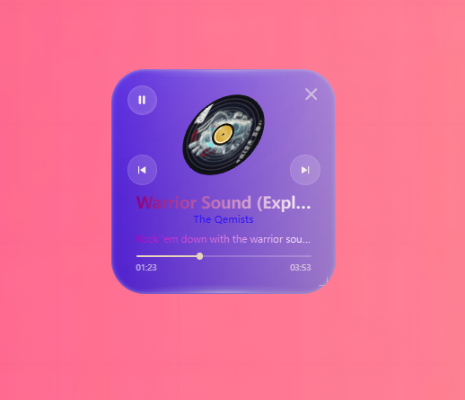
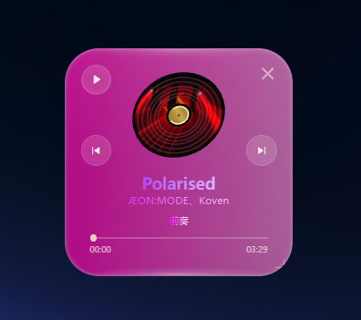

# KUGOUPLAY

KUGOUPLAY 是一款搭配 Windows 版酷狗音乐使用的桌面播放器。它将歌曲信息、歌词与播放控制放进一块可调整颜色的液态玻璃组件，并用旋转的 3D 黑胶唱片展示歌曲封面。

## 效果图

| :---: | :---: |
|  |  |
|  |  |

## 功能

- **桌面播放控制**：显示歌名、歌手、歌词、播放进度，支持播放／暂停、上一曲和下一曲。进度条目前仅用于显示。
- **3D 黑胶封面**：唱片自动旋转，拖动封面可以调整观看角度。
- **自定义颜色**：点击唱片打开调色界面，分别设置玻璃底色、歌名、歌手和歌词的颜色；可开启从左到右的渐变，玻璃底色也可设为透明。设置会自动保存，并可恢复默认。
- **桌面组件**：窗口默认置顶；拖动空白处移动，拖动右下角调整大小，点击右上角关闭。

## 下载与使用

1. 在 [Releases 页面](https://github.com/shenruyang123456/kugousmallplay/releases) 下载 `KUGOUPLAY.exe`。
2. 确保已安装 Windows 版酷狗音乐，然后双击 `KUGOUPLAY.exe`。首次显示可能需要一些时间，因为程序会自动释放内置运行文件。
3. 等待组件连接酷狗。点击唱片可调整颜色；拖动唱片可改变角度。

单文件版包含播放器、本地桥接服务、Node.js、Meting 和固定版 WebView2，不需要单独安装 Python 或配置这些依赖。程序运行时使用用户临时目录，正常退出后通常自动清理；日志保存在 `%LOCALAPPDATA%\KugouMusicPlay\bridge.log`。

## 使用须知

- 面向 **Windows x64** 和 Windows 版酷狗音乐。液态玻璃依赖桌面捕获和 Direct3D，视觉效果与兼容性取决于系统及显卡。
- 如果酷狗已经以普通方式运行，且没有开启组件需要的调试接口，请先完全退出酷狗；组件会尝试使用所需参数重新启动它。组件不会强制关闭正在运行的酷狗。
- 歌曲封面与歌词需要联网；是否能显示取决于对应歌曲资料和网络服务。
- 程序会排除自身的 Desktop Duplication 捕获以避免玻璃重影。因此使用该方式的截图工具可能无法拍到组件，其他截图方式的结果取决于工具。
- 内置的固定版 WebView2 不会自动更新，需随播放器发布更新版本。

## 开发与构建

桌面组件源码位于 `glass-widget/`，酷狗连接与本地服务位于项目根目录。普通桌面组件的构建方式见 [组件开发说明](glass-widget/README.md)。

在准备好 Rust MSVC、C++ 构建工具、Node.js、Python、PyInstaller、kugo-mcp 依赖和固定版 WebView2 的 Windows 构建环境中，可运行：

```powershell
powershell -File packaging/build.ps1
```

输出文件为 `dist/KUGOUPLAY.exe`。脚本支持通过 `-McpHome` 和 `-WebViewRuntime` 指定构建依赖路径；这些路径不影响最终便携版的运行。第三方许可证随程序打包。更多接口与实现说明见 [kogouminplay.md](kogouminplay.md)。
